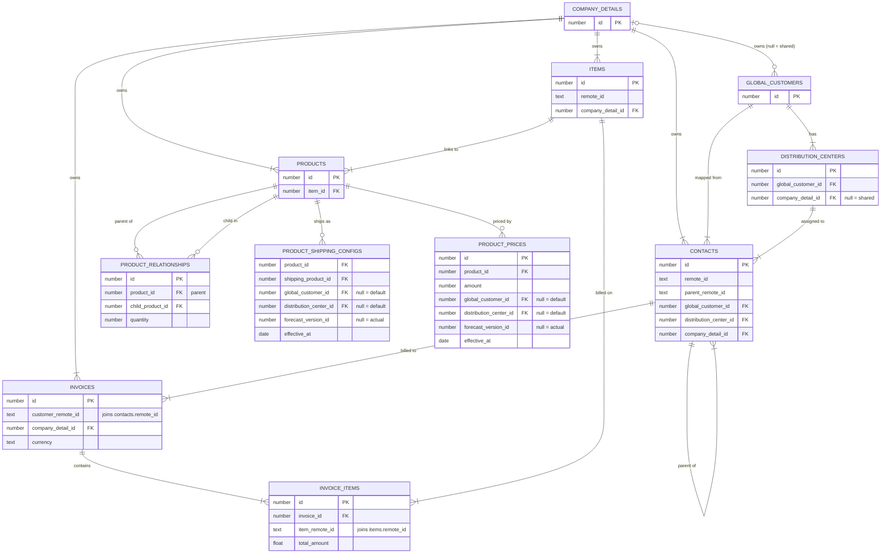

# About
_This README created 2026-10-15 and updated 2026-11-04 (quantities extension)_

This is the dbt repository for Zoë's Confido take home.

# Setup Notes
Use DBT_ENV_SECRET_CONFIDO_SNOWFLAKE_PASSWORD as environment variable for password
MFA for Snowflake through dbt only worked with Duo push, not a passkey
Install with requirements.txt on dbt Core, then run `dbt deps` to install dbt_utils

```bash
pip install -r requirements.txt
dbt deps
dbt build --select +fct_invoice_items
```

# The model
**Who's who.** A *company* (`company_details`) is Confido's customer: a CPG brand that owns its products, items, contacts and invoices. A *global customer* is where companies ship and sell to (retailers, distributors), with *distribution centers* as their warehouses. Global customers and DCs are mostly shared across companies, so two brands invoicing the same retailer resolve to the same global customer. Current data has one company, but every model is built for many.

`fct_invoice_items`: one row per line item on a **paid** invoice, with the line amount and references to Confido internal entities where the data supports them.

| Reference | Columns | Lines mapped |
|---|---|---|
| Product | `product_id`, `product_name`, `product_mapping_status` | 1,651 (65%) |
| Global customer | `global_customer_id`, `global_customer_name`, `global_customer_mapping_status` | 911 (36%) |
| Distribution center | `distribution_center_id`, `distribution_center_name` | 0 (see open questions) |

## Quantities: cases, packs and singles
Each line's original `quantity` is converted to `case_quantity` (Operations), `pack_quantity`, and `single_quantity` (Manufacturing), through the line's case (`case_product_id`, `packs_per_case`, `singles_per_case`, `single_product_id`).

| `quantity_price_check` | Meaning | Lines (non-GEN / GEN) |
|---|---|---|
| `matches_case_price` | Unit price within 1% of the expected case price | 485 / 0 |
| `differs_from_case_price` | Within 2x: a customer price difference (e.g. Strawberry Multipack billed at 25.25 vs list 29); quantity is still cases | 91 / 0 |
| `not_a_case_price` | Quantity isn't cases: lump sums (quantity 1, line total as unit price) or the GEN_ batch (unit price 1). Don't use the converted quantities | 100 / 975 |
| `no_case_price` | No product (ambiguous, services, trade spend) so nothing to convert | 113 / 763 |

How a line is converted:
1. **Level of the invoiced product** (`int_product_components`): `case` (CaseV2), `shipper` (ShipperProduct), `pack` (no type, has children, e.g. a multipack), `single` (no type, no children).
2. **The quantity is in cases** when the invoiced product is a case or shipper. That's every mapped line today, consistent with "assume case unless the invoice says otherwise". A line invoiced as a single or pack is counted at that level instead.
3. **The case** is the invoiced product itself, or for singles and packs the case their `product_shipping_configs` row names: most specific first (DC, then global customer, then default), in effect on the invoice date.
4. **Packs and singles per case** come from walking `product_relationships` down every level, multiplying quantities (Strawberry Multipack case = 8 multipacks = 32 cups).
5. **The price check** compares `unit_price` to the case's `product_prices` row, using the same precedence and effective date.

- **Unmapped references are null.** The `*_mapping_status` columns say why, e.g. `ambiguous_item` or `unmapped_contact`.
- **Source names are kept for traceability:** the accounting system's item and customer IDs and names (`item_remote_id`, `item_name`, `customer_remote_id`, `contact_name`). Unmapped lines are still readable.
- **Lines reconcile to the source line by line** in `int_invoice_items_enriched` (paid and unpaid): `unique` on `invoice_item_id`, `dbt_utils.equal_rowcount`, and `dbt_utils.equality` on (`invoice_item_id`, `amount`) against staging. The fact table then keeps only paid invoices (`paid_on_date` is set).
- **Mapping tables created for debugging** Logic could be handled in invoice items or invoice model but is separated to faster identify when something changes.

## Layers
- **`staging/`:** one model per source table from `CONFIDO_DEMO.PUBLIC`. Rename, cast and light cleanup only.
- **`intermediate/`:**
  - `int_items_mapped_to_products`: one row per item. Product only when exactly one product links to the item.
  - `int_product_components`: one row per product per product it contains at any depth (including itself). Recursive walk of `product_relationships`, multiplying quantities per level (Mixed fruit pack case → 4 packs → 4 of each of 3 cups).
  - `int_products_packaging`: one row per product with its level, packs and singles per product, and the single when there's only one kind.
  - `int_contacts_mapped_to_global_customers`: one row per contact. Falls back to the parent contact's global customer.
  - `int_invoice_items_enriched`: one row per invoice line, all joins.
  - `int_invoice_items_quantities`: one row per invoice line. Resolves the case, shipping config and price for the line's customer, DC and date, and converts the quantity.
- **`marts/`:** `fct_invoice_items`, which joins the published columns from `int_invoice_items_enriched` and `int_invoice_items_quantities`.
  `fct_invoices` rolls the same lines up to one row per paid invoice and compares billed with expected amounts (rolled-up case quantity × expected case price).

## Source ERD
The source tables behind `fct_invoice_items`, simplified to the intended relationships: every match is required, as "exactly one" (`||`) or "one or many" (`|{`). In the actual data some of these links are missing (e.g. items with no product, contacts with no global customer or DC), which the `*_mapping_status` columns capture.



# Assumptions
- **Company scoping.** Company-owned entities (items, contacts, products, invoices) only join within their company: remote ID joins use `company_detail_id` + remote ID, and items only map to their company's products. Global customers and DCs may be shared (null company) or owned by one company; a company may reference shared ones or its own, never another company's. `tests/assert_no_cross_company_references.sql` checks every such reference (contacts, DCs, products, relationships, shipping configs, prices). Shipping configs and prices have no company column; they belong to their product's company, while their customer and DC overrides point at shared entities.
- **Remote IDs are unique per company.** Joins use `company_detail_id` + remote ID, backed by uniqueness tests in staging.
- **An unmapped contact inherits its parent contact's global customer.** One level only.
- **Currency is passed through as-is.** Amounts aren't converted, and null currency isn't assumed to be USD.
- **Coverage** It's better to have coverage even if it may change later. i.e. a duplicate product id is added so a previously covered item no longer has an assigned product.
- **Sync fields** Assume that _updated_at fields that look like sync timing is that rather than something else.
- **Negative lines are deductions** (`is_deduction`), e.g. EDLP, retailer spoils, early pay discount, not refunds. No invoice nets negative and no refund or credit memo records were found. The same deduction items sometimes appear with positive amounts, so the flag follows the sign rather than the item.
- **Singles are products with no children.** Quantities multiply down every level. `single_product_id` is only set when a case holds one kind, so shippers and mixed packs aren't flattened into one product, though `single_quantity` is still their total.
- **Forecast scenarios are ignored.** Shipping config and price rows with a `forecast_version_id` (124, 118) duplicate or adjust the actual rows for forecasting.
- **DCs are shared or company-specific.** 1,147 of 1,152 DCs have no `company_detail_id`, so DC joins accept a matching or null company, like global customers.
- **Timestamps** that are currently only dates are better as dates for joining and won't be replaced by timestamps.

# Key decisions
- **Ambiguous items stay unmapped rather than guessed.** "Yogurt" links to 5 products and "Ice cream" to 2. A plain join would duplicate lines (2,527 → 5,853) and inflate the total to $13.20M. Picking the most recently updated product, or matching on unit price, didn't hold up in the data.
- **No guessed customer mappings.** Contacts without a global customer (e.g. Kroger, Trader Joe's) stay unmapped. Names aren't a reliable key: there are two "Kroger" global customers, and existing mappings don't always follow names.
- **No catch-all distribution center.** Every global customer has an "All Other DCs" record, but using it would only restate the customer. The DC comes only from the contact, which is empty in the current data.
- **Product relationships don't resolve ambiguous items.** Yogurt's 5 products are 5 separate flavour cases with no common parent, and Ice cream's 2 are unrelated units (one is an unnamed test-looking product, 799). They stay `ambiguous_item`.
- **Convert every line, flag the untrustworthy ones.** Quantities are converted wherever a case is known, and `quantity_price_check` says whether to trust them, rather than nulling them. Outside the GEN_ batch, `quantity × unit_price = amount` on every product line, so where the unit price is a case price the quantity is cases. The flag lets Operations and Manufacturing filter to `matches_case_price` / `differs_from_case_price` without losing lines from the dollar totals.
- **One table, line grain.** Cases, packs and singles sit side by side on `fct_invoice_items` so both audiences reconcile to the same lines and dollars. Shippers and mixed packs get a total `single_quantity` but no single product; a line × single model is a next step if Manufacturing needs SKU-level volume for them (no mapped line is a shipper today).
- **Company is on every line** (`company_detail_id`, `company_name`). Global customer totals span brands, so compare or filter by company before reading a shared customer's volume.
- **Only paid invoices are published.** That's the one filter; everything else, including unmapped lines, is kept, so totals match the accounting data for paid invoices. Data-quality concerns are documented below rather than encoded as flags, except `quantity_price_check`, which users need to read quantities correctly.
- **Scope:** two fact tables (line and invoice grain), no dimension models. Two source tables that aren't on the invoice path (map_contact_subsidiaries, retailers) aren't staged.


# Open questions
1. **What is the batch of 1,738 invoices** with `GEN_` invoice numbers, `GENERATED_` customer IDs and null currency? Is it test data, and should it be included?
2. **How to handle duplicate ids** Updated
3. **How should invoices be assigned to distribution centers?** Is "All Other DCs" the intended default?
4. **Should the unmapped contacts (Kroger, Trader Joe's, Publix) be mapped?** Is "UNFI West" → SuperValu correct?
5. **Are remote IDs unique per company,** or per subsidiary or accounting integration?
6. **Is there a reliable test-data flag?** GEN_xx invoices and other names with test in them could be.
7. **What does invoice quantity mean** when `unit_price = 1`? Every such line is in the GEN_ batch, where quantity is roughly the dollar amount.
8. **Is a multipack a single?** Strawberry and Chocolate Multipacks have their cups as children (a case = 8 packs = 32 cups), but Blueberry Multipack has none (a case = 8 singles), so their `single_quantity` isn't comparable today.
9. **Product names look swapped in places:** Chocolate (case) and Chocolate Multipack contain "Vanilla Ice Cream - 10oz Bin". Names are passed through as-is.

# Next steps
- Consider PIT measures. We only have current state and clearly things change given the PREVENT_CUSTOMER_REMAPPING field. Could be used for mapping correct products if only one version of item_remote_id exists at a time.
- Build staging models for those sources not used in invoice items model.
- Build intermediate models into a separate, restricted schema.
- Currency conversion to USD for foreign currency to speak in similar language on aggregate level.
- Add an `int_invoices` model once invoice-level logic exists (de-duplication, batch classification).
- Line × single model for shippers and mixed packs (allocating amount), if Manufacturing needs SKU-level volume for them.
- Detect single-level lines from price: two Strawberry Cups lines have unit price 3.06 ≈ 25.25 / 8, so their quantity is likely singles, not cases.
- Exclude test products (799, 801, 12936, 12951) once there's a reliable flag; dropping 799 would map Ice cream to a single (764), converted through its shipping config.
- Add CI running `dbt build`, source freshness checks, and currency conversion.
