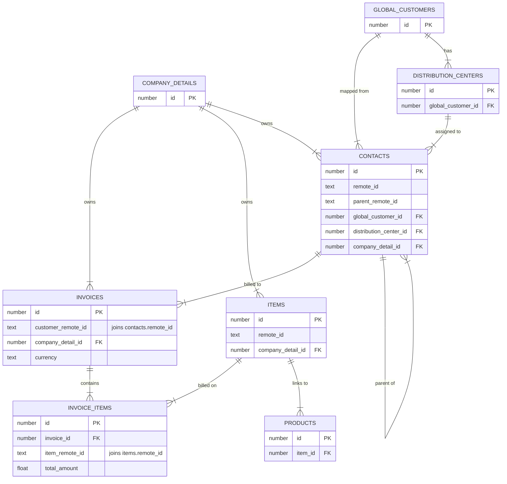

# About
_This README created 2026-10-15 and updated 2026-10-18_

This is the dbt repository for Zoë's Confido take home.

# Setup Notes
Use DBT_ENV_SECRET_CONFIDO_SNOWFLAKE_PASSWORD as environment variable for password
MFA for Snowflake through dbt only worked with Duo push, not a passkey
Install with requirements.txt on dbt Core, then run `dbt deps` to install dbt_utils

```bash
pip install -r requirements.txt
dbt deps
dbt build --select +fct_invoice_items
```

# The model
`fct_invoice_items`: one row per line item on a **paid** invoice, with the line amount and references to Confido internal entities where the data supports them.

| Reference | Columns | Lines mapped |
|---|---|---|
| Product | `product_id`, `product_name`, `product_mapping_status` | 1,651 (65%) |
| Global customer | `global_customer_id`, `global_customer_name`, `global_customer_mapping_status` | 911 (36%) |
| Distribution center | `distribution_center_id`, `distribution_center_name` | 0 (see open questions) |

- **Unmapped references are null.** The `*_mapping_status` columns say why, e.g. `ambiguous_item` or `unmapped_contact`.
- **Source names are kept for traceability:** the accounting system's item and customer IDs and names (`item_remote_id`, `item_name`, `customer_remote_id`, `contact_name`). Unmapped lines are still readable.
- **Lines reconcile to the source line by line** in `int_invoice_items_enriched` (paid and unpaid): `unique` on `invoice_item_id`, `dbt_utils.equal_rowcount`, and `dbt_utils.equality` on (`invoice_item_id`, `amount`) against staging. The fact table then keeps only paid invoices (`paid_on_date` is set).
- **Mapping tables created for debugging** Logic could be handled in invoice items or invoice model but is separated to faster identify when something changes.

## Layers
- **`staging/`:** one model per source table from `CONFIDO_DEMO.PUBLIC`. Rename, cast and light cleanup only.
- **`intermediate/`:**
  - `int_items_mapped_to_products`: one row per item. Product only when exactly one product links to the item.
  - `int_contacts_mapped_to_global_customers`: one row per contact. Falls back to the parent contact's global customer.
  - `int_invoice_items_enriched`: one row per invoice line, all joins.
- **`marts/`:** `fct_invoice_items`, which selects the published columns from the intermediate layer.

## Source ERD
The source tables behind `fct_invoice_items`, simplified to the intended relationships: every match is required, as "exactly one" (`||`) or "one or many" (`|{`). In the actual data some of these links are missing (e.g. items with no product, contacts with no global customer or DC), which the `*_mapping_status` columns capture.



# Assumptions
- **Remote IDs are unique per company.** Joins use `company_detail_id` + remote ID, backed by uniqueness tests in staging.
- **An unmapped contact inherits its parent contact's global customer.** One level only.
- **Currency is passed through as-is.** Amounts aren't converted, and null currency isn't assumed to be USD.
- **Coverage** It's better to have coverage even if it may change later. i.e. a duplicate product id is added so a previously covered item no longer has an assigned product.
- **Sync fields** Assume that _updated_at fields that look like sync timing is that rather than something else.
- **Negative lines are deductions** (`is_deduction`), e.g. EDLP, retailer spoils, early pay discount, not refunds. No invoice nets negative and no refund or credit memo records were found. The same deduction items sometimes appear with positive amounts, so the flag follows the sign rather than the item.
- **Timestamps** that are currently only dates are better as dates for joining and won't be replaced by timestamps.

# Key decisions
- **Ambiguous items stay unmapped rather than guessed.** "Yogurt" links to 5 products and "Ice cream" to 2. A plain join would duplicate lines (2,527 → 5,853) and inflate the total to $13.20M. Picking the most recently updated product, or matching on unit price, didn't hold up in the data.
- **No guessed customer mappings.** Contacts without a global customer (e.g. Kroger, Trader Joe's) stay unmapped. Names aren't a reliable key: there are two "Kroger" global customers, and existing mappings don't always follow names.
- **No catch-all distribution center.** Every global customer has an "All Other DCs" record, but using it would only restate the customer. The DC comes only from the contact, which is empty in the current data.
- **Only paid invoices are published.** That's the one filter; everything else, including unmapped lines, is kept, so totals match the accounting data for paid invoices. Data-quality concerns are documented below rather than encoded as flags.
- **Scope:** one fact table, no dimension models. Quantity and unit price aren't published. Five source tables that aren't on the invoice path aren't staged.


# Open questions
1. **What is the batch of 1,738 invoices** with `GEN_` invoice numbers, `GENERATED_` customer IDs and null currency? Is it test data, and should it be included?
2. **How to handle duplicate ids** Updated
3. **How should invoices be assigned to distribution centers?** Is "All Other DCs" the intended default?
4. **Should the unmapped contacts (Kroger, Trader Joe's, Publix) be mapped?** Is "UNFI West" → SuperValu correct?
5. **Are remote IDs unique per company,** or per subsidiary or accounting integration?
6. **Is there a reliable test-data flag?** GEN_xx invoices and other names with test in them could be.

# Next steps
- Consider PIT measures. We only have current state and clearly things change given the PREVENT_CUSTOMER_REMAPPING field. Could be used for mapping correct products if only one version of item_remote_id exists at a time.
- Build staging models for those sources not used in invoice items model.
- Build intermediate models into a separate, restricted schema.
- Currency conversion to USD for foreign currency to speak in similar language on aggregate level.
- Add an `int_invoices` model once invoice-level logic exists (de-duplication, batch classification).
- Add CI running `dbt build`, source freshness checks, and currency conversion.
